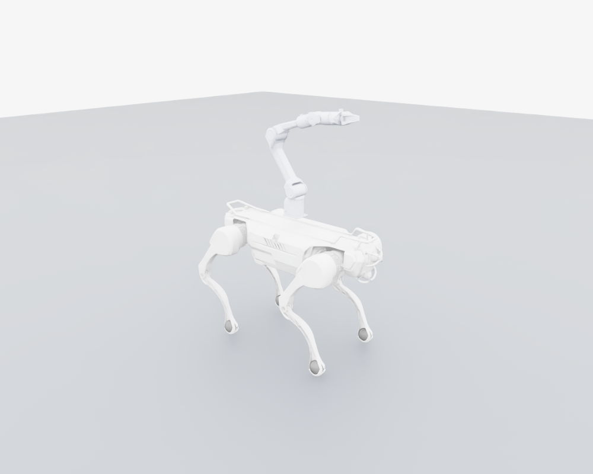

# X30-Piper 足式移动操作

## 模型和安装

项目新增 X30 四足底座与六轴 Piper 机械臂的组合模型，独立于现有 M20-Piper，不改变 M20 的模型、任务或动作接口。



- 保存的独立 USD：`deep_robotics_model/X30_Piper/usd/X30_Piper.usd`。
- 可编辑的组合 URDF：`deep_robotics_model/X30_Piper/urdf/X30_Piper.urdf`。
- 上游来源：DeepRoboticsLab/deep_robotics_model，固定提交 `549eb9ac08ab0674ad388202f0a276a1b140833b`。底座取自 `X30/urdf/X30.urdf`，机械臂和夹爪取自 `M20_Piper/urdf/M20_Piper.urdf`，保留原始质量、惯量、关节轴和限位。
- 安装：背部居中、朝前；`TORSO -> arm_base_link` 固定变换为 XYZ `[0, 0, 0.14]` 米、RPY `[0, 0, 0]`。机身网格最高点约 0.13535 米，安装面留有约 4.65 毫米间隙。这是理想刚性安装，未添加实际转接板的质量、柔性或紧固件；实机安装尺寸与载荷仍需确认。
- 四个足端增加与原有碰撞球相同的可视球（半径 0.036 米），不修改碰撞形状。无网格的雷达参考链接保留，但没有模拟雷达数据。
- USD 已展平，几何和 Preview Surface 材质内置，无外部 USD、网格或 MDL 依赖。URDF 使用项目内 X30/M20_Piper 的相对网格路径，需保留相邻模型目录。
- 本任务始终加载项目内 X30-Piper USD，不受 `DEEP_ROBOTICS_MODEL_DIR` 的 M20 路径覆盖影响。X30 的方向直接来自组合 URDF，无需套用 M20-Piper 的运行时方向修正。

底座 12 个关节均保留 X30 官方方向：HipX 为 `-X`，HipY/Knee 为 `-Y`。四条腿默认角度相同：HipX `0`、HipY `-0.65`、Knee `+1.30` rad；不要复制 M20 的前后腿不同符号姿态。初始机身高度为 0.55 米，默认脚底约在地面上方 2.8 厘米。

机械臂默认角度为 `[0, 1.0, -1.2, 0, 0.2, 0]` rad，夹爪闭合。跟踪的是 `gripper_base` 法兰，不是两指之间的抓取 TCP。

## 任务与动作

已注册四个任务：

- `X30-PIPER-Flat` / `X30-PIPER-Flat-Play`：末端 XYZ 与姿态相对 `arm_base_link`。
- `X30-PIPER-WBC` / `X30-PIPER-WBC-Play`：末端 XY 相对 `arm_base_link`，Z 为世界高度，姿态仍相对机械臂底座。

模型共 20 个活动关节：12 个腿关节、6 个机械臂关节、2 个夹爪滑动关节。策略仅输出 18 个位置增量动作：

| 动作 | 顺序 | 缩放 |
| --- | --- | --- |
| 0–11 | FL、FR、HL、HR，各自 HipX、HipY、Knee | HipX 0.125，其余 0.25 rad |
| 12–17 | joint1 … joint6 | 0.25 rad |

目标角为默认角加缩放后的动作，RSL-RL 包装器将原始动作裁剪到 ±5。夹爪由独立 PD 保持闭合，不受策略控制。没有轮速动作。policy 观测 210 维（三帧历史），critic 102 维；关节观测和力矩项只取 18 个受控关节。

环境使用四个 `*_FOOT` 接触传感器，保留足底滑移、腾空时间、长时间离地、腾空方差和对角腿一致性项；机身碰撞/倾倒终止作用于 `TORSO`。平地移动包含前后、横移和转向，物理 200 Hz、控制 50 Hz、回合 20 秒。现有随机化机制保留，默认关闭外力推搡。

## 参数依据与限制

| 参数 | HipX / HipY | Knee |
| --- | --- | --- |
| 力矩上限（官方 URDF） | 84 Nm | 150 Nm |
| 速度上限（官方 URDF） | 17.5 rad/s | 16.1 rad/s |
| Kp（仿真初值） | 200 | 240 |
| Kd（仿真初值） | 5 | 6 |

默认姿态及腿部 PD 增益参考本机 LeggedGym 的 `x30_rfm_linear_multicritic_loco_dw_config.py`，不是声称来自厂商官方 X30 locomotion 配置；本机官方 RL Training 快照未发现 X30 任务。控制延迟设为 0–1 个物理步，机身高度奖励目标为 0.50 米，均为待训练验证的初值。

Piper 执行器沿用本项目 M20-Piper 的仿真候选参数：力矩 `[20, 20, 15, 7, 5, 5]` Nm，Kp `[50, 50, 80, 30, 30, 20]`，Kd `[3, 2, 3, 3, 2.5, 1]`。不是经厂商确认的实机参数。自碰撞当前关闭，与现有任务保持一致，不能作为碰撞安全策略部署。

PPO 网络/优化器复用现有 RSL-RL 5 基线，但使用独立实验目录 `x30_piper_flat` / `x30_piper_wbc`。M20、GO2 或其他机器人的 checkpoint 不能直接用于此机器人。该任务不包含抓取物体、实机部署或 MuJoCo 策略适配。

## 预览与检查（不训练）

在已有环境中执行，无需新装 Isaac Lab 或 PyTorch：

```bash
conda activate rl-training
cd ~/LeggedManip_Lab
python scripts/preview_x30_piper.py
```

预览暂停在默认姿态，关闭窗口即可退出。以下是有界验证，不更新任何策略权重：

```bash
python scripts/list_envs.py --keyword X30
python scripts/smoke_x30_piper.py --headless --task X30-PIPER-Flat
python scripts/smoke_x30_piper.py --headless --task X30-PIPER-WBC
python scripts/smoke_x30_piper.py --headless --task X30-PIPER-WBC --check_actions
```

动作检查将底座悬空固定，在 36 个环境分别施加 18 个动作的正负输入，对比 URDF 正运动学与 PhysX 的各链接位姿，验证动作顺序、正负方向、夹爪隔离、裁剪、观测以及未训练 actor 经 RSL 包装器到关节目标的路径。普通检查验证自由底座、足底奖励、末端奖励坐标与超时重置；零动作测试不是训练后的平衡性能评价。

2026-10-14 在本机 `rl-training` 环境的验证结果：

- Flat、WBC 各 4 个环境、200 步检查通过，观测和状态保持有限，末端奖励坐标与强制超时重置正确。
- 18 个关节的正负响应全部通过；实际未训练 actor 输出经包装器正确送到 18 个位置目标，夹爪独立控制。
- 36 个动作探测环境的 URDF/PhysX 位姿最大偏差约 `1.17e-6` 米、`1.51e-6` rad，未发现动作方向与模型坐标不一致。
- 独立 USD 依赖检查通过，并完成默认姿态离屏渲染。组合模型总质量约 60.509 kg（仅模型惯性数据，不是实物称重）。
- 随机化开启时，200 步零动作测试中 Flat 出现 3 次、WBC 出现 2 次提前重置；当前是未训练的环境，不应解读为稳定站立或移动操作已成功。没有启动 PPO 学习或生成训练 checkpoint。

若修改安装变换，编辑构建脚本中的 `base_to_arm` 位移并重建：

```bash
python scripts/build_x30_piper.py --headless
```

构建脚本使用已安装的 URDF 转换器，临时中间文件在结束后清除，仅保存组合 URDF 和独立 USD。不要修改上游 X30/M20_Piper 原文件来改变此组合模型。

## 由用户手动启动训练

本次适配不自动启动训练。检查模型并确认后，用户可选择一个任务：

```bash
python scripts/rsl_rl/train.py --task X30-PIPER-WBC --headless --num_envs 1024 --max_iterations 10000
```

需要 Flat 时将任务改成 `X30-PIPER-Flat`。回放使用对应的 `-Play` 任务和自己训练的 checkpoint。
